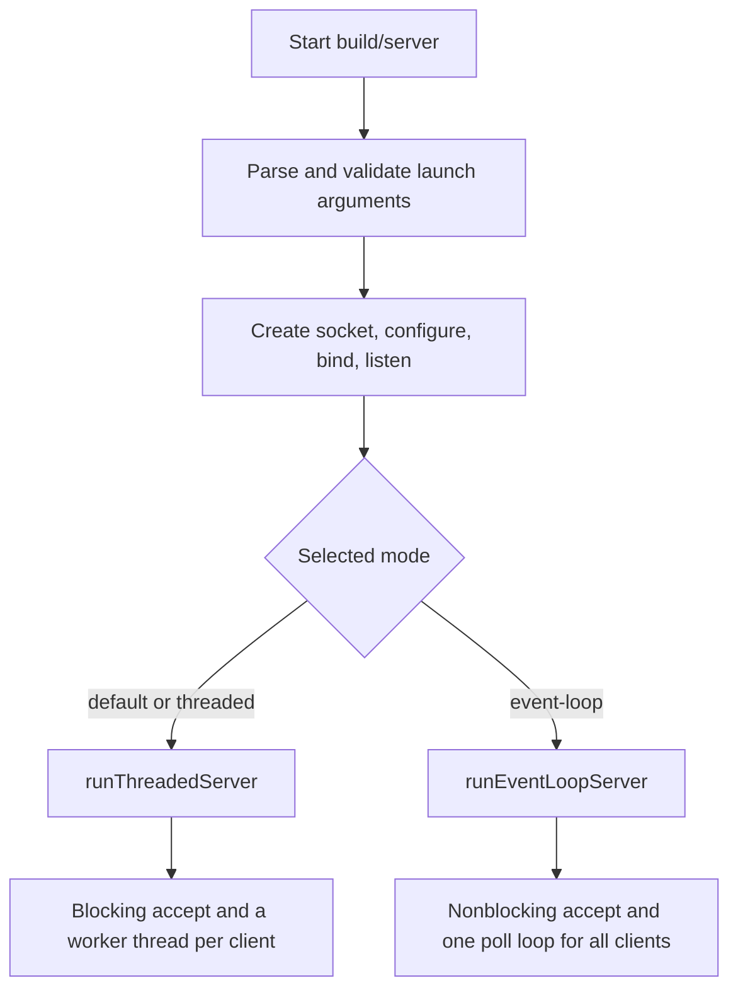
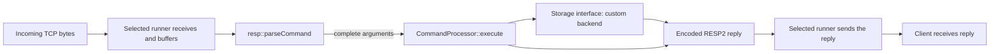

# Current architecture: two connection models, one RESP2 server

The server separates **how connections are scheduled and serviced** from
**how requests are parsed and commands are executed**. Both connection models
are compiled into `build/server`; a launch option selects one for the entire run.
The client and the RESP2 wire format are identical in either mode.

## 1. Where the decision happens

The decision is entirely in [server/main.cpp](../server/main.cpp).

```bash
./build/server                     # Threaded mode by default
./build/server --mode threaded
./build/server --mode event-loop
./build/server --mode event-loop --buffer regular
./build/server --mode event-loop --buffer offset
```

Event-loop mode defaults to the offset input buffer. `--buffer` explicitly chooses
the original string prefix-erasure behavior or the improved read-offset behavior;
it requires event-loop mode. Both run the same event-loop template, with the buffer
type selected once at startup. See [BUFFER_HANDLING.md](BUFFER_HANDLING.md).

At startup, `main()` validates the arguments and sets `bool eventLoop`. It then
creates the listening socket, enables address reuse, binds to `127.0.0.1:6379`,
and calls `listen()`. It creates one shared command processor with the custom
storage backend, then dispatches to exactly one runner:

```cpp
auto commands = std::make_shared<CommandProcessor>(storage::makeCustomStorage());
return eventLoop ? runEventLoopServer(listener.get(), commands, bufferMode)
                 : runThreadedServer(listener.get(), commands);
```



Selection happens once, before clients are accepted. Every connection in that
process uses the selected model. Changing modes means restarting with the other
option. Both implementations coexist in the source and executable; only one runs
per launch. Two server processes cannot both bind this same address and port with
the current configuration.

## 2. What is shared and what each model owns

| Responsibility | Location | Shared or specific? |
| --- | --- | --- |
| Launch options and listener setup | `server/main.cpp` | Shared entry point. |
| Runner declarations | `server/runners/runners.h` | Common entry-point convention. |
| Accept and thread creation | `server/runners/threaded.cpp` | Threaded mode. |
| Polling, connection states, nonblocking I/O | `server/runners/event_loop.cpp` | Event-loop mode. |
| RESP2 parsing, encoding, and limits | `common/resp.h`, `common/resp.cpp` | Shared by both runners and the client. |
| Commands, synchronization, and reply construction | `server/commands/commands.h`, `server/commands/commands.cpp` | One shared processor for both runners. |
| Storage and sorted-set interfaces/adapters | `server/storage/storage.h`, `server/storage/storage.cpp` | Shared in-memory database. |
| Hash table and augmented AVL tree | `server/storage/data_structures/` | Custom storage internals. |
| Socket lifetime management | `net::Socket` in `common/net.h` | Shared ownership utility. |
| Blocking receive and send-all helpers | `common/net.h` | Used by threaded mode and the client. |
| Client UI and request/reply exchange | `client/main.cpp` | Works with either server mode. |

Every successful request follows the same logical data path:



The parser converts bytes into arguments. `CommandProcessor::execute()` validates
them, uses the replaceable storage interface, and returns an encoded RESP2 reply.
It does not accept a socket or know which runner called it. A mutex protects each
storage command and its copied reply snapshot; PING/ECHO bypass the database.
Incomplete or malformed requests are handled by the runner using the parser's
status; incomplete requests do not enter the command executor.

This is a shared logical pipeline, with separate I/O control flow in each runner.
There is no single shared connection-handler object or callback framework.
Adding a command normally changes `commands.cpp` once, while changing how sockets
are scheduled changes the relevant runner.

## 3. Two complete request-response traces

For an animated view of the event-loop and offset-buffer path, open the
[interactive request explorer](../visualizer/dist/index.html). It shows the bytes,
function calls, and state changes in a browser-local simulation; see
[its usage notes](VISUALIZER.md).

These charts start after the common setup in section 1: `main()` has created the
listener and the shared `CommandProcessor`. Read each chart from top to bottom.
Rectangles perform work, diamonds choose a branch, and rounded **lettered
connectors** continue at the matching letter in the same chart. For example,
"Return to A" means repeat the step marked A; it does not mean close the client.
These connectors keep repeated paths readable without long arrows across the page.

The supplied client encodes commands with `resp::encodeCommand()` and sends their
bytes with `net::sendAll()`. TCP may deliver one request in several reads or several
requests together. Both server paths therefore parse their retained bytes before
receiving more. **One `parseCommand()` call handles at most one command.**

### Threaded mode: one blocking worker per connection

Source: [server/runners/threaded.cpp](../server/runners/threaded.cpp), with blocking socket helpers
in [common/net.h](../common/net.h).

The accept thread and each worker run independently. The successful-start arrows
from "Create and detach worker" represent concurrent progress: the accept thread
continues accepting while the new worker handles its own client.

The entry letters are **A** (accept), **H** (initialize the worker), **P** (parse),
**R** (execute and reply), and **C** (close this client). Each numbered stage is
read from top to bottom; its connector names the next stage or repeated step.

```mermaid
flowchart TB
    subgraph TAccept ["1. Accept thread: runThreadedServer"]
        direction TB
        TA["A: blocking accept()<br/>Wait for a connection"]
        TAR{"accept result?"}
        TSpawn["Create and detach worker<br/>handleClient(fd, commands)"]
        TNext(["Return to A<br/>Accept another client"])
        TNew(["New worker: go to H<br/>Runs independently"])
        TSpawnFail["Worker creation failed<br/>Log and close accepted fd"]
        TStop(["Fatal accept error<br/>Return 1; server exits"])
        TA --> TAR
        TAR -->|"Client fd"| TSpawn
        TAR -->|"EINTR"| TNext
        TAR -->|"Other error"| TStop
        TSpawn -->|"Accept thread"| TNext
        TSpawn -->|"Worker starts"| TNew
        TSpawn -->|"Creation throws"| TSpawnFail
        TSpawnFail --> TNext
    end

    subgraph TRead ["2. Worker: own socket, parse, and receive"]
        direction TB
        TOwn["H: own fd with net::Socket<br/>Create persistent string input"]
        TP["P: parseCommand(input)<br/>Parse first buffered command"]
        TPS{"Parser status?"}
        TRecv["receiveMore(fd, input)<br/>Blocking recv: up to 4096 bytes<br/>Helper retries EINTR"]
        TRS{"recv result?"}
        TAppend["Append received bytes<br/>Retain all unread input"]
        TAgain(["Return to P<br/>Parse input again"])
        TProtocol["Attempt protocol-error reply<br/>Using blocking sendAll()"]
        TReadFail["EOF or receive error<br/>Log errors or partial-command EOF"]
        TToReply(["Go to R<br/>Execute this command"])
        TReadClose(["Go to C<br/>Finish this worker"])
        TOwn --> TP --> TPS
        TPS -->|"Incomplete"| TRecv
        TRecv --> TRS
        TRS -->|"Bytes received"| TAppend
        TAppend --> TAgain
        TRS -->|"EOF or error"| TReadFail
        TReadFail --> TReadClose
        TPS -->|"Protocol error"| TProtocol
        TProtocol --> TReadClose
        TPS -->|"Complete"| TToReply
    end

    subgraph TReply ["3. Worker: execute, send reply, then consume request"]
        direction TB
        TExec["R: CommandProcessor::execute()<br/>Validate and build RESP2 reply<br/>Use locked storage as needed"]
        TSend["sendAll(fd, reply)<br/>Repeat blocking send<br/>Advance offset on partial writes<br/>Retry EINTR"]
        TSent{"Entire reply sent?"}
        TConsume["input.erase(0, consumed)<br/>Remove this request only<br/>Retain following pipeline bytes"]
        TReplyAgain(["Return to P<br/>Parse before receiving more"])
        TReplyClose(["Go to C<br/>Finish this worker"])
        TExec --> TSend --> TSent
        TSent -->|"Yes"| TConsume
        TConsume --> TReplyAgain
        TSent -->|"No: zero or error"| TReplyClose
    end

    subgraph TFinish ["4. End one client connection"]
        direction TB
        TException["Worker throws std::exception<br/>Catch and log it"]
        TClose(["C: return from handleClient()<br/>Socket destructor closes fd<br/>Other clients and database remain"])
        TException --> TClose
    end

    TAccept ~~~ TRead
    TRead ~~~ TReply
    TReply ~~~ TFinish

    classDef continuation fill:#e8f1ff,stroke:#2456a6,color:#142b4d;
    classDef closed fill:#fdecec,stroke:#a93232,color:#5c1515;
    class TNext,TNew,TAgain,TToReply,TReadClose,TReplyAgain,TReplyClose continuation;
    class TStop,TClose closed;
```



**What repeats:** After a successful reply, the worker immediately parses the
remaining input. If a pipelined command is already complete, it executes without
another `recv()`. If no complete command remains, that worker blocks waiting for
more bytes. Its local input string and the running function retain progress.

**What closes the connection:** A parser error attempts an error reply and then
returns regardless of send success. EOF, receive failure, send failure, or a
`std::exception` caught inside `handleClient()` also ends that worker. Stage 4
shows this last case; the catch covers parsing and socket-helper work as well as
command execution. `sendAll()` can block this worker until the socket can accept
the remaining reply bytes.

### Event-loop mode: one thread resumes each Conn when ready

Source: [server/runners/event_loop.cpp](../server/runners/event_loop.cpp), with input-buffer operations
in [server/buffers/input_buffer.h](../server/buffers/input_buffer.h).

A `Conn` retains the work that must survive a handler returning:

| Field | Meaning |
| --- | --- |
| `socket` | Owns the client fd. |
| `commands` | Refers to the shared command processor retained by the runner. |
| `state` | `Request`: need input; `Response`: have a reply; `End`: remove connection. |
| `input` | Unread request bytes, including partial and following pipelined commands. |
| `output` | One pending encoded reply. |
| `sent` | Number of bytes already accepted by `send()` from that reply. |
| `closeAfterWrite` | Close after draining a protocol-error reply. |

The diagram separates the poll cycle from the handlers into six numbered stages.
Their lettered connectors make each continuation explicit:

| Letter | Continue at |
| --- | --- |
| A | Build the next poll snapshot and wait. |
| B | Visit the next client in the current snapshot. |
| R | Enter `handleRead()` with `received = 0`. |
| P | Parse again inside that read handler, keeping `received`. |
| W | Check the write gate; entering `handleWrite()` sets `written = 0`. |
| S | Repeat the send loop, keeping `written` and `sent`. |
| N | Inspect buffered pipeline input after the reply drains. |
| C | Remove and close this connection. |

The **write trigger** in stage 4 means the current `revents` contains `POLLIN`,
`POLLOUT`, or `POLLHUP`. Including `POLLIN` allows an optimistic write immediately
after the read handler creates a reply. Each read/write invocation has a separate
64 KiB budget; the next invocation gets a fresh byte counter.

```mermaid
flowchart TB
    subgraph ESetup ["1. Select buffer and wait for readiness"]
        direction TB
        EStart["Choose buffer once<br/>regular: string erase<br/>offset: advance read position<br/>Make listener nonblocking"]
        EPoll["A: rebuild poll list<br/>Listener: POLLIN<br/>Request clients: POLLIN<br/>Response clients: POLLOUT<br/>Call poll with timeout -1"]
        EPollResult{"poll result?"}
        EListener{"Listener reports<br/>ERR, HUP, or NVAL?"}
        EAccept["If listener has POLLIN:<br/>handleNewConnections()<br/>Accept up to 64 clients<br/>Make each fd nonblocking<br/>Store a new Request-state Conn"]
        EAcceptResult{"Fatal accept error?"}
        EStop(["Return 1<br/>Server exits"])
        EAgain(["Return to A<br/>Rebuild list and poll again"])
        EStart -->|"Success"| EPoll
        EStart -->|"fcntl failure"| EStop
        EPoll --> EPollResult
        EPollResult -->|"EINTR"| EAgain
        EPollResult -->|"Other error"| EStop
        EPollResult -->|"Events available"| EListener
        EListener -->|"Yes"| EStop
        EListener -->|"No"| EAccept
        EAccept --> EAcceptResult
        EAcceptResult -->|"Yes"| EStop
        EAcceptResult -->|"No"| ESToClients(["Go to B<br/>Visit snapshot clients"])
    end

    subgraph EDispatch ["2. Visit clients in the poll snapshot"]
        direction TB
        EClients{"B: any unvisited<br/>snapshot clients?"}
        EEvents{"This fd has revents?"}
        EFault{"POLLERR or POLLNVAL?"}
        EReadGate{"Request state and<br/>POLLIN or POLLHUP?"}
        EClients -->|"No"| EDToPoll(["Return to A<br/>Next poll cycle"])
        EClients -->|"Yes: inspect next fd"| EEvents
        EEvents -->|"Yes"| EFault
        EFault -->|"No"| EReadGate
        EReadGate -->|"Yes"| EReadStart(["Go to R"])
        EReadGate -->|"No"| EDToWrite(["Go to W"])
        EEvents -->|"No"| EDToB(["Return to B<br/>Next snapshot client"])
        EFault -->|"Yes"| EDToEnd(["Go to C: close"])
    end

    subgraph ERead ["3. Read handler: parse before receiving"]
        direction TB
        ERStart["R: handleRead(): received = 0"]
        ERParse["P: prepareResponse()<br/>Parse first buffered command"]
        ERStart --> ERParse
        ERStatus{"Parser status?"}
        ERBudget{"64 KiB received?"}
        ERecv["Nonblocking recv()<br/>Up to 4096 bytes,<br/>within remaining read budget"]
        ERecvResult{"recv result?"}
        EAppend["Append bytes to input<br/>Increase received counter"]
        EReadAgain(["Return to P<br/>Keep received counter"])
        EExecute["Execute command; queue reply<br/>Consume this request only"]
        EProtocol["Queue protocol-error reply<br/>Clear input<br/>closeAfterWrite = true"]
        EResponse["sent = 0; state = Response<br/>Return from handleRead()"]
        ERParse --> ERStatus
        ERStatus -->|"Incomplete"| ERBudget
        ERBudget -->|"No"| ERecv
        ERecv --> ERecvResult
        ERecvResult -->|"Bytes received"| EAppend
        EAppend --> EReadAgain
        ERecvResult -->|"EINTR"| EReadAgain
        ERStatus -->|"Complete"| EExecute
        ERStatus -->|"Protocol error"| EProtocol
        EExecute --> EResponse
        EProtocol --> EResponse
        EResponse --> ERToWrite(["Return from read<br/>Go to W"])
        ERBudget -->|"Yes"| ERToWrite
        ERecvResult -->|"EAGAIN"| ERToWrite
        ERecvResult -->|"EOF or other error"| ERToEnd(["Go to C: close"])
    end

    subgraph EWrite ["4. Try the pending reply in this same dispatch"]
        direction TB
        EWriteGate{"W: Response state<br/>and write trigger?"}
        EWriteStart["handleWrite(): written = 0"]
        EWriteLoop{"S: unsent bytes and<br/>write budget left?"}
        ESend["Nonblocking send()<br/>Start at output.data() + sent<br/>Respect remaining write budget"]
        ESendResult{"send result?"}
        EAdvance["Increase sent and written<br/>Retain the unsent suffix"]
        EWriteAgain(["Return to S<br/>Keep written counter"])
        EDrained{"Reply fully sent?"}
        EClear["Clear output; sent = 0"]
        ECloseAfter{"closeAfterWrite?"}

        EWriteGate -->|"Yes"| EWriteStart
        EWriteStart --> EWriteLoop
        EWriteLoop -->|"Yes"| ESend
        ESend --> ESendResult
        ESendResult -->|"Bytes sent"| EAdvance
        EAdvance --> EWriteAgain
        ESendResult -->|"EINTR"| EWriteAgain
        EWriteLoop -->|"No"| EDrained
        EDrained -->|"Yes"| EClear
        EClear --> ECloseAfter
        ECloseAfter -->|"Yes"| EWToEnd(["Go to C: close"])
        ECloseAfter -->|"No"| EWToPipeline(["Go to N: pipeline"])
        EWriteGate -->|"No"| EWToB(["Return to B<br/>Next snapshot client"])
        ESendResult -->|"EAGAIN"| EWKeep["Keep Response, output, sent"]
        EWKeep --> EWToB
        EDrained -->|"No: budget used"| EWKeep
        ESendResult -->|"Zero or other error"| EWToEnd
    end

    subgraph EPipeline ["5. After a reply drains: inspect buffered pipeline"]
        direction TB
        ERequest["N: state = Request<br/>Call prepareResponse() once again<br/>No recv() in this step"]
        ENextStatus{"Buffered parser status?"}
        ENextComplete["Execute next command<br/>Put its reply in output<br/>Consume that request's bytes"]
        ENextError["Queue protocol-error reply<br/>Clear input<br/>closeAfterWrite = true"]
        ENextQueued["sent = 0; state = Response<br/>Return from handleWrite()<br/>Next poll: POLLOUT"]
        ENextIncomplete["Keep unread bytes<br/>Remain in Request state<br/>Next poll: POLLIN"]

        ERequest --> ENextStatus
        ENextStatus -->|"Complete"| ENextComplete
        ENextStatus -->|"Protocol error"| ENextError
        ENextStatus -->|"Incomplete"| ENextIncomplete
        ENextComplete --> ENextQueued
        ENextError --> ENextQueued
        ENextQueued --> ENToB(["Return to B<br/>Next snapshot client"])
        ENextIncomplete --> ENToB
    end

    subgraph EFinish ["6. Close this client connection"]
        direction TB
        EEnd["C: state = End"]
        EException["Handler throws std::exception<br/>Catch and log it"]
        EException --> EEnd
        ECleanup["Remove this connection"]
        EClose["fd2Conn[fd].reset()<br/>Destroy Conn and close fd<br/>Shared database remains"]
        EContinue(["Return to B<br/>Visit next snapshot client"])
        EEnd --> ECleanup
        ECleanup --> EClose
        EClose --> EContinue
    end

    ESetup ~~~ EDispatch
    EDispatch ~~~ ERead
    ERead ~~~ EWrite
    EWrite ~~~ EPipeline
    EPipeline ~~~ EFinish

    classDef continuation fill:#e8f1ff,stroke:#2456a6,color:#142b4d;
    classDef closed fill:#fdecec,stroke:#a93232,color:#5c1515;
    class EAgain,EContinue,EReadAgain,EWriteAgain,ESToClients,EDToPoll,EReadStart,EDToWrite,EDToB,EDToEnd,ERToWrite,ERToEnd,EWToB,EWToEnd,EWToPipeline,ENToB continuation;
    class EStop,EClose closed;
```



`EAGAIN` in the chart includes `EWOULDBLOCK`. `EINTR` means interrupted by a signal;
the operation is retried. `POLLIN` indicates possible readable input, `POLLOUT`
possible write capacity, and `POLLHUP` a hangup that can accompany unread bytes.
`POLLERR` and `POLLNVAL` end a client connection immediately. Readiness flags are
hints: `recv()`/`send()` still determine how much progress is possible.

**How to follow the event-loop chart:**

| Situation | Exact continuation |
| --- | --- |
| A new connection arrives | The accept handler stores its Conn. It was not in the existing poll snapshot, so its first client dispatch is in a later poll cycle. |
| Input is incomplete | P checks the read budget and receives more. Each successful receive or EINTR returns to P to parse first, keeping the current read counter. |
| Read would block | Return to the dispatcher with input preserved. State remains Request, so the write gate is skipped and the next poll watches POLLIN. |
| Read budget is exhausted | Parsing has already been attempted before the budget check. Retain Request state if still incomplete and let other clients proceed. |
| A complete command arrives | Build one reply, consume only that request, set Response, and immediately reach the write gate in the same dispatcher turn. |
| Optimistic write | The triggering event may be POLLIN without POLLOUT. The write gate still permits the attempt after a read creates a Response. |
| A partial send succeeds | S advances `sent` and `written`, then tries the unsent suffix again while the write budget permits. |
| Write would block or uses its budget | Preserve output and `sent` in Response state. Finish this client turn; a later POLLOUT dispatch resumes the reply with a fresh write counter. |
| A normal reply drains | Clear output and reset `sent`, set Request, then call `prepareResponse()` once on the remaining buffered input. |
| A complete next pipeline request exists | Execute it now and queue its reply. `handleWrite()` returns; that next reply is sent in a later dispatch, without requiring new client bytes. |
| Parser reports a protocol error | Queue an error, clear input, and set `closeAfterWrite`. Remain in Response until the error reply drains or sending fails. |
| EOF occurs | Finish the connection. If unread input remains, log that the client closed during a command. Parsing before recv lets complete buffered requests receive replies before EOF is observed. |
| A handler throws `std::exception` | The per-client catch logs the error and sets End. Follow step 6 to remove that connection. |
| State becomes End | Reset its owning slot, closing the fd and freeing connection buffers. Other clients and stored values are unaffected. |

The accept box summarizes a bounded loop: `EINTR` retries, `EAGAIN` finishes the
handler, and `ECONNABORTED` skips a canceled connection while counting it against
the 64-connection budget. If setting a newly accepted fd nonblocking fails, that
socket is closed and accepting continues. Other accept errors stop the server.
Exceptions outside per-client dispatch, such as an allocation failure while
accepting or rebuilding the poll snapshot, reach `main()`'s exception handler
and stop the server.

### Command execution and client receipt in both paths

The command nodes call the same [CommandProcessor](../server/commands/commands.cpp). It
normalizes the command name. PING/ECHO validate their arguments and encode a
reply directly. Other commands acquire the mutex, validate their arguments,
call the [Storage interface](../server/storage/storage.h) where needed, and encode the
result. Returning releases the mutex **before either runner writes to a socket**.
For example, GET looks up a key in the custom hash table; a sorted-set rank or
range query uses the member hash index and augmented AVL tree. See
[STORAGE.md](STORAGE.md) for those command-specific traces.

A command error, such as wrong arguments, an unknown command, or WRONGTYPE, is
an ordinary encoded reply: the request was parsed correctly and the connection
continues. A **protocol error** comes from `parseCommand()` and closes the
connection after an attempted error reply. Keep these two branches separate
when reading the charts.

The client receives reply bytes independently of server scheduling. Its `query()`
function keeps bytes in an input string, calls `resp::parseReply()`, and receives
more if the reply is incomplete. Once complete, it prints the reply, erases only
its consumed bytes, and returns. A successful server send means bytes were
accepted by the local socket, not that the client has already read or printed them.

### Differences visible in the two traces

| Detail | Threaded mode | Event-loop mode |
| --- | --- | --- |
| Where client progress lives | Worker function, local input, and `sendAll()` offset. | Persistent Conn: state, input, output, and `sent`. |
| When no bytes can be read/written | That worker can block inside recv/send. | Handler returns on EAGAIN; poll schedules another turn. |
| When parsed request bytes are consumed | After `sendAll()` completes the reply. | After execution produces the reply, before sending it. |
| Following complete pipeline request | Parse and execute immediately after the current reply is sent. | Parse and execute after the reply drains; queue the next reply for a later dispatch. |
| Input buffering | Original string with prefix erasure. | Selected regular wrapper or offset FIFO. |
| Scheduling limits | No per-worker byte budget. | 64 KiB per read/write handler; 64 accepts per accept-handler turn. |
| Slow reader | Blocks its worker during send. | Retains one reply, watches POLLOUT, and pauses reads for that client. |

## 4. Ownership at the runner boundary

Both runners have the same entry-point shape, declared in
[server/runners/runners.h](../server/runners/runners.h):

```cpp
int runThreadedServer(int listener, std::shared_ptr<CommandProcessor> commands);
int runEventLoopServer(int listener, std::shared_ptr<CommandProcessor> commands,
                       InputBufferMode bufferMode = InputBufferMode::Offset);
```

`main()` owns the listener through `net::Socket`; the runner receives its borrowed
fd. Passing this integer neither duplicates the socket nor transfers ownership.
The selected runner accepts clients and manages their lifetimes. Event-loop mode
can change the listener's flags to nonblocking because it is the sole active runner.

In threaded mode, `handleClient()` owns each accepted socket. In event-loop mode,
ownership moves from a temporary `net::Socket` into `Conn`; destroying the Conn
closes that fd. Listener ownership stays with `main()` in both cases.

Runners normally keep running; unrecoverable listener/poll failures return an error
status. This interface currently has no stop/drain API. RAII closes sockets during
normal scope exit or C++ exception unwinding; Ctrl+C terminates the process without
a graceful drain of pending work.

## 5. Can a third method be added?

**Yes: the connection runners are separate modules with a small common entry
point.** A third method can reuse listener setup, RESP2 parsing, and command
execution while implementing its own connection scheduling and buffers.

For example, adding an `epoll` runner would require these integration edits:

1. Implement `int runEpollServer(int listener, std::shared_ptr<CommandProcessor> commands)`
   in a new `server/runners/epoll.cpp`, keeping
   the same listener ownership contract and RESP2 behavior.
2. Declare it in `server/runners/runners.h`.
3. Add its source and any new headers to the Makefile's server build lists.
4. Extend `main.cpp` argument validation, help text, and dispatch for the new mode.
5. Add that mode to the integration test loop in `tests/integration.py`, and update
   any tests that explicitly check the supported mode names.

The existing client, parser, storage backend, and command processor can stay as they are.
`Conn` and the poll handlers are currently private to `event_loop.cpp`, so another
runner cannot directly reuse them. If two event runners need the same connection
state and nonblocking handlers, those pieces can be extracted into a shared module
when that need arises.

The connection-model selector is a two-choice boolean, with a separate enum for
event-loop input buffering. A third connection model should replace the boolean
with an enum and a switch, for example:

```cpp
// Possible future dispatch; this is not implemented today.
enum class ServerMode { Threaded, Poll, Epoll };

switch (mode) {
case ServerMode::Threaded: return runThreadedServer(listener.get(), commands);
case ServerMode::Poll:     return runEventLoopServer(listener.get(), commands, bufferMode);
case ServerMode::Epoll:    return runEpollServer(listener.get(), commands);
}
```

Modularity here means an additional implementation needs a new module plus a few
explicit integration edits. There is no automatic registration or dynamic loading
of plugins. That small design fits the current incremental learning stage.

## 6. What the next milestone builds on

Storage is implemented through Chapter 11: a custom hash table owns the keyspace,
and sorted sets combine a member hash index with an augmented AVL tree. All
connections use the same database through simple interfaces described in
[STORAGE.md](STORAGE.md). Backend replacement happens at construction; no STL
production backend is installed yet. [COMMANDS.md](COMMANDS.md) lists the commands.

Chapters 12–13 would add connection timers and key expiration. They are not
implemented here. The database has no persistence and starts empty after restart.

See [README.md](../README.md) for build/run instructions,
[PROJECT_DETAILS.md](PROJECT_DETAILS.md) for the chapter progression, and
[PERFORMANCE.md](PERFORMANCE.md) for the planned comparison of the two modes.
