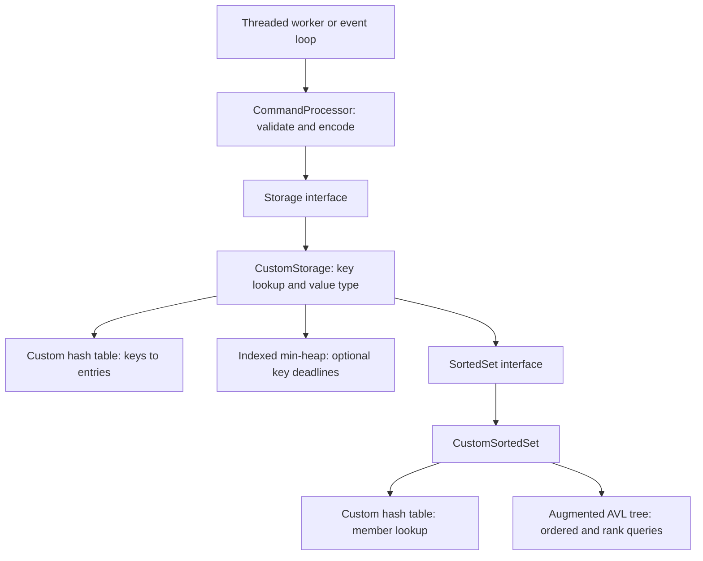

# Storage and commands without learning the internals

The server now covers storage through Chapter 13: string values, a custom hash
table, an augmented AVL tree, sorted sets, and optional key TTLs. You can trace commands through the
public API without reading bucket migration or tree rotations.

## Read these layers in order

| Layer | File | What you need to understand |
| --- | --- | --- |
| Commands and replies | [commands.cpp](../server/commands/commands.cpp) | Argument validation, storage calls, and RESP2 reply encoding. |
| Storage contract | [storage.h](../server/storage/storage.h) | What each operation does and what its result means. |
| Custom storage adapter | [storage.cpp](../server/storage/storage.cpp) | A key holds a string or a sorted set; sorted sets use two indexes. |
| Hash implementation, optional | [hash_table.h](../server/storage/data_structures/hash_table.h) | Buckets, collision chains, node ownership, and progressive rehashing. |
| Tree implementation, optional | [avl_tree.h](../server/storage/data_structures/avl_tree.h) | Balancing, subtree counts, ordering, rank, and selection. |
| TTL heap, optional | [min_heap.h](../server/storage/data_structures/min_heap.h) | Deadline ordering and maintaining each entry's heap index. |



## The public interfaces

`storage::Storage` represents one database. Its calls use keys and ordinary values:

```cpp
auto store = storage::makeCustomStorage();
store->set("greeting", "hello");
auto result = store->get("greeting");
// result.status == storage::Status::Ok; result.value == "hello"
bool removed = store->erase("greeting");
```

| API | Meaning |
| --- | --- |
| `get(key)` | Read a string; report `NotFound` or `WrongType` when appropriate. |
| `set(key, value)` | Create or replace the value with a string. |
| `erase(key)` | Delete a whole key; return whether it existed. |
| `keys()` | Return a sorted snapshot of all keys. |
| `expire(key, seconds)` | Set/update TTL, or delete immediately for nonpositive durations. |
| `ttl(key)` | Return rounded seconds remaining, -1 for no TTL, -2 for missing. |
| `persist(key)` | Remove a TTL and keep the value. |
| `nextTTLDeadlineMS()` | Read the nearest monotonic deadline in O(1), or return no deadline. |
| `processTTLExpirations(now, limit)` | Delete at most `limit` due keys; the default is 2,000 per pass. |
| `zadd(key, members)` | Add/update `{member, score}` pairs; return the number newly added. |
| `zrem(key, members)` | Remove members; return their count and delete the key if the set becomes empty. |
| `zscore(key, member)` | Read a member's score. |
| `zrank(key, member)` | Read its zero-based position. |
| `zcard(key)` | Read the number of members. |
| `zquery(key, score, member, offset, limit)` | Seek, offset, and return ordered member/score pairs. |

`Result<T>` contains a status and a value. Statuses are `Ok`, `NotFound`, and
`WrongType`. Use `value` only according to the operation's status. Missing keys
produce zero counts or empty results for `zrem`, `zcard`, and `zquery`, and
`NotFound` for `get`, `zscore`, and `zrank`.

`storage::SortedSet` describes a single collection, independently of the keyspace.
It provides `add`, `remove`, `score`, `rank`, `size`, and `query`. Its `score` and
`rank` methods return an optional value when a member may be absent. Scores must
not be NaN. Results own their strings and vectors; no node pointers, borrowed
views, or STL iterators escape these interfaces.

## Where data lives

`main()` creates one storage backend and puts it in one `CommandProcessor`.
All connections share that processor. The database therefore survives individual
client disconnects and is visible across clients; it lasts for the server process.
There is no disk persistence, snapshot loading, or append log. Runners schedule
TTL expiration; lookups also remove expired entries before using them.

The top-level hash table owns each `Entry`. An entry has one key, a string value,
and an optional owned sorted-set object. A null sorted-set pointer identifies a
string entry; a non-null pointer identifies a sorted-set entry. We use ordinary
C++ objects rather than manually constructing a tagged union.

Each entry also has `heap_idx`, initially `NoHeapIndex`. A timed entry has exactly
one node in the storage-owned min-heap. The heap borrows a typed pointer to the
entry and updates `heap_idx` on every move. Hash migration never moves the entry.
Every entry deletion removes its timer before destroying it; replacing a value
with `SET` also removes its timer. See [TIMERS.md](TIMERS.md) for the full flow.

Each sorted-set member owns its name and score once. The member hash table owns
that object. The AVL tree links to the same object, providing a second index
without duplicating member names. Removing a member detaches it from the tree
before destroying it through the owning hash table. Removing a key destroys its
value and all its members through RAII.

## How the commands work

**SET:** Validate the argument count. Copy the new value, look up the key, and
insert an entry if absent. For an existing key, replace its string and destroy any
previous sorted set, and remove its TTL. Return `+OK`.

**GET:** Look up the key through the hash table. If absent, return a null bulk
string. If it holds a sorted set, return `WRONGTYPE`. Otherwise copy its string
into the result and encode that value as a bulk string.

**DEL:** Remove each supplied key from the hash table. Destruction releases the
value and any member collection. Return an integer count of keys actually removed.

**KEYS:** Visit entries in both tables if rehashing is in progress. Copy their
names, sort them for stable output, and encode the snapshot as an array.

**ZADD:** Validate every score first. Look up or create the sorted-set key. For a
new member, create one object and put it in both indexes. For an existing member,
detach its tree node, update the score, and reinsert it in order; its name index
and identity remain. Return the count of new members, excluding score updates.

**ZREM:** Locate each member by name. Detach it from the ordered tree and owning
hash index, then release the object. Delete the whole key when no members remain.
Return the number of removed members.

**ZSCORE:** Locate the member through its name hash table and return its score as
a bulk string. Missing keys/members return null.

**ZRANK:** Locate the member by name. Ask the ordered index for the number of
members before it. Return that zero-based rank as an integer, or null if missing.

**ZCARD:** Return the member count already maintained by the sorted set.

**ZQUERY:** Find the first `(score, member)` pair at or above the supplied pair.
Find that node's rank, add the signed offset if it stays in bounds, and select
the resulting rank. Walk forward from there, copying up to `limit` pairs. The
command encoder returns a flat array of alternating names and score strings.

**PING/ECHO:** Build replies directly without looking at storage.

## What the custom structures provide

The hash table uses power-of-two bucket arrays, FNV-1a byte hashing, and embedded
singly linked collision chains. It grows when its load reaches two entries per
bucket. During growth there are old and new tables; lookups search both. Each
lookup/insertion/deletion helps move old nodes, with a budget of 64 migration
steps counting both nodes and empty bucket scans. Member/entry addresses stay
stable. New bucket allocation is synchronous, and collisions can still make
operations slow; progressive rehashing limits migration work, not all latency.

The AVL tree keeps height differences bounded while preserving tuple order. Each
node also stores its subtree's member count. Those counts support rank and
selection without walking over every skipped member. You only need that guarantee
to follow `ZRANK` or a large-offset `ZQUERY`.

| Operation | Expected cost, excluding key/value byte copying |
| --- | --- |
| Key or member lookup | Average O(1), worst O(N) for collision chains. |
| New sorted-set member or score change | Average O(log N), combining a hash lookup and tree operations. |
| Rank or offset selection after member lookup | O(log N) in the AVL tree. |
| Query returning K pairs | Average O(log N + K), plus copied result bytes. |
| Member count | O(1). |
| KEYS | O(N log N) because the returned keys are sorted. |
| Delete a sorted-set key | Includes freeing all its members. |

STL strings, vectors, and smart pointers handle byte storage, bucket allocations,
and lifetime. They do not implement the associative lookup, rehash migration, tree
balancing, or rank algorithms here. The collision chains, indexed min-heap, and
embedded connection idle links are custom data structures too; vectors provide
their underlying storage where needed.

## Swapping in STL later

There are two replacement boundaries already present:

1. Implement `storage::Storage` with an STL keyspace and pass that object to
   `CommandProcessor`. Command parsing, reply encoding, and both runners keep
   calling the same API. The construction line in `main()` chooses the backend.
2. Implement `storage::SortedSet` with STL indexes and pass its factory to
   `makeCustomStorage(factory)`. This keeps the custom keyspace but replaces each
   sorted-set collection, useful for a more focused comparison.

The interfaces describe behavior, not complexity requirements: an STL rank
implementation may walk entries while the custom tree jumps by subtree counts.
Both must agree on ordering, result ownership, score updates, missing values,
and type errors. There is no STL production backend or backend-selection flag yet.

## Concurrency and verification

`CommandProcessor` holds a mutex around one complete storage command and its reply
snapshot. Threaded clients therefore cannot race while accessing the same database;
even a hash lookup can help rehash and change internal links. The event loop uses
the same processor on its single thread. PING/ECHO bypass storage and the mutex.
The mutex is released before socket writes, so a slow reader does not hold it.
Raw storage/set interfaces require external synchronization when shared.

Multi-key/multi-member commands cannot interleave with other clients. Malformed
scores are rejected before updates. Allocation failure is not a transaction
rollback mechanism; earlier changes in a multi-item command may already exist if
a later allocation fails. The runner closes that client on an uncaught allocation
exception. Large deletion, listing, or query work is synchronous and can delay
other clients in event-loop mode; later chapters address some long-running work.

`make test` runs hash migration and ownership checks, randomized AVL ordering,
parent/height/count/balance checks, sorted-set comparisons against independent STL
reference results, command validation and concurrent writes, RESP2 reply parsing,
and real TCP integration tests for threaded mode and both buffer strategies.
