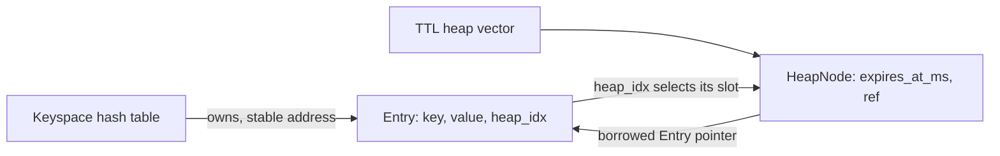
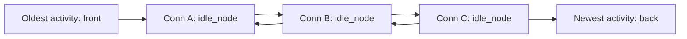
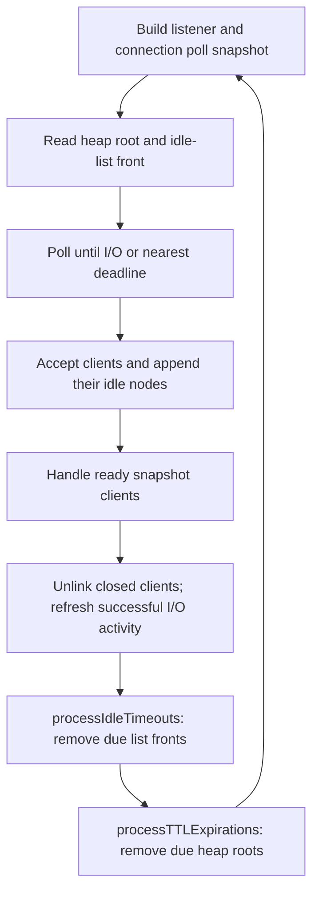

# Connection idle timers and key TTLs

The two timer structures follow [Chapter 12](https://build-your-own.org/redis/12_timer)
and [Chapter 13](https://build-your-own.org/redis/13_heap) of *Build Your Own Redis*.
Public `EXPIRE` and `TTL` values use seconds, as requested; the book's sample uses
milliseconds. Internal deadlines use monotonic milliseconds.

| Timer | Structure | Owner | Update cost | Nearest deadline |
| --- | --- | --- | --- | --- |
| Optional key TTL | `vector<HeapNode<Entry>>` min-heap | `CustomStorage` | O(log N) heap repair; insertion can also grow the vector | Heap root, O(1) |
| Uniform connection idle timeout | Intrusive doubly linked list | `EventLoopState` | O(1) insertion, refresh, removal | Front connection, O(1) |

## Where to read the code

| File | Responsibility |
| --- | --- |
| [min_heap.h](../server/storage/data_structures/min_heap.h) | Heap insertion, update, deletion, and owner-index maintenance. |
| [storage.cpp](../server/storage/storage.cpp) | Entry TTLs, command storage operations, expiration checks, and safe key destruction. |
| [commands.cpp](../server/commands/commands.cpp) | Validate `EXPIRE`/`TTL`/`PERSIST`, encode replies, and synchronize all storage access. |
| [idle_list.h](../server/timers/idle_list.h) | Embedded two-pointer list links and constant-time list operations. |
| [event_loop.cpp](../server/runners/event_loop.cpp) | Runner state, `refreshTimer`, `nextTimerMS`, `processIdleTimeouts`, and `processTimers`. |
| [time.h](../server/timers/time.h) | Steady-clock milliseconds, timer budget, and conversion to a safe `poll()` timeout. |

## Key TTL ownership and indexes

The keyspace hash table owns every `Entry`. Each entry starts with
`heap_idx = NoHeapIndex`, meaning it has no expiration. Setting a TTL creates one
heap node containing an absolute `expires_at_ms` deadline and a borrowed `Entry*`.
The entry's `heap_idx` points back to that node's vector slot.

`MinHeap<Entry>` uses a typed entry pointer rather than a pointer to only the
integer index. This keeps the same two-field heap node and updates
`ref->heap_idx` on every move, while letting expiration recover the owner without
a C-style `container_of` cast. Hash-table rehashing relinks entries without moving
them in memory. Vector growth moves heap nodes but leaves entry addresses stable.

`createOrUpdateTTLTimer()` passes the entry to `MinHeap::createOrUpdate()`:

1. If the entry has no timer, append a node and record its index.
2. Otherwise replace its existing deadline, preserving one node per entry.
3. Repair upward or downward, updating each moved entry's `heap_idx`.

Removal moves the vector's last node into the removed slot, pops the last slot,
resets the removed owner's index, and repairs the replacement. `PERSIST` does this
without deleting the entry. It never creates a heap node.

All whole-key deletion routes go through `eraseEntry()`: remove the heap node
first, then remove and destroy the owned entry. This includes `DEL`, expiration,
and deleting a sorted set's final member. `SET` removes the old TTL before replacing
the value. Updating an existing sorted set preserves its TTL. New keys are permanent
until `EXPIRE` is used.

Expired entries are also checked on lookup. At `deadline <= now`, the entry is
removed before a command sees its value or type. `KEYS` filters expired entries
while traversing and leaves their destruction to timer processing or a later lookup;
it never changes hash chains during iteration.

## Connection idle list

`Conn` embeds `idle_node` with `prev` and `next` connection pointers, plus
`last_active_ms`. The list borrows connections owned by `fd2Conn`; there is no
separate node allocation and no additional ownership of sockets.

Every accepted connection gets the current timestamp and is appended to the list.
After handlers run, a connection that successfully read or wrote bytes gets a new
timestamp and moves to the back in O(1). Partial requests and partial sends count;
readiness notifications, `EAGAIN`, and parsing buffered bytes alone do not.

All connections in a process have the same idle timeout, so ordering by last
activity also orders their idle deadlines. The default is **60,000 ms**.
`--idle-timeout-ms N` selects a different positive timeout, up to `INT_MAX` ms,
for event-loop mode. It applies to both buffer choices and to connections waiting
for input or stalled while sending output.

`destroyConnection()` detaches the embedded node before resetting `fd2Conn[fd]`.
The `Conn` destructor destroys its `net::Socket`, whose destructor closes the fd.
Every EOF, protocol error, socket error, handler exception, and idle expiration
uses this same cleanup path.

Both runners log `Connection accepted (fd=N)` after acceptance and
`Connection closing (fd=N): reason` when ending that connection. A `CloseLog`
guard records closure before the owning socket is destroyed; it does not own or
close the descriptor. Reasons distinguish idle timeouts, client disconnects,
incomplete requests, protocol errors, and socket/handler/setup failures.

## One event-loop iteration

`nextTimerMS()` chooses the smaller of the heap root deadline and the idle-list
front's `last_active_ms + idleTimeoutMS`. It returns:

- `-1` if neither structure has a timer;
- `0` if the closest timer is already due;
- the milliseconds until that timer, capped at `INT_MAX` for `poll()`.

Choosing the deadline is O(1); building and scanning the existing poll snapshot
still depends on the connections/fd slots. Idle refreshes do not affect key TTLs.

At the end of the iteration, `processTimers()` captures `now`, removes due idle
connections, then processes due TTL heap roots. It stops at the first future
deadline. Interrupted polls also process timers before retrying.

TTL deletion is limited to **2,000 keys per pass**, following the chapter's work
budget. If due roots remain, the next poll timeout is zero, so I/O is checked
between batches. This bounds the number of key deletions, not their total cost:
destroying one large sorted set still frees all its members synchronously.

## Threaded mode and shared storage

The original worker-per-client model and blocking worker I/O remain available.
TTL commands use the same storage and heap in both modes. `CommandProcessor`'s
mutex protects command snapshots, timer-deadline reads, and TTL processing.
No lock is held while waiting in `poll()` or doing client socket I/O.

The threaded accept thread polls the listener and runs bounded TTL maintenance.
It caps its wait at **100 ms**, because a worker can insert an earlier deadline
after the accept thread has started waiting. This reclaims expired entries without
new client traffic or an additional maintenance thread. Keys are always checked
on access, independent of this maintenance delay.

Idle connection timers apply to the event-loop runner. Threaded workers retain
their previous connection lifetime; they do not share the event-loop idle list.

## Commands and verification

See [COMMANDS.md](COMMANDS.md) for syntax and replies. TTL rounds to the nearest
second, including returning `0` for a still-live key with under 500 ms left, as in
[Redis's TTL implementation](https://github.com/redis/redis/blob/unstable/src/expire.c).
`-1` means no TTL and `-2` means missing. Nonpositive `EXPIRE` deletes immediately.
Overflow is checked before changing a timer.

`make test` includes deterministic fake-clock expiration checks, randomized heap
updates/removals against independent expected deadlines, owner-index validation,
randomized idle-list ordering, timer cleanup on value/key deletion, large expiry
batches, command validation, concurrent TTL commands, and TCP tests in both modes.
The TCP idle checks use the timeout option to cover inactive clients, active clients,
fragmented requests, stalled output, and fd reuse without waiting 60 seconds per case.
